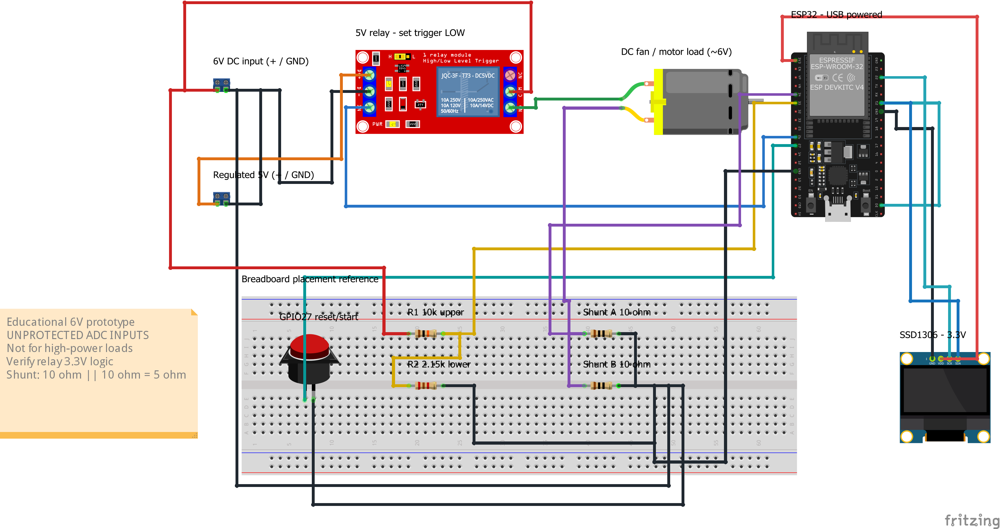
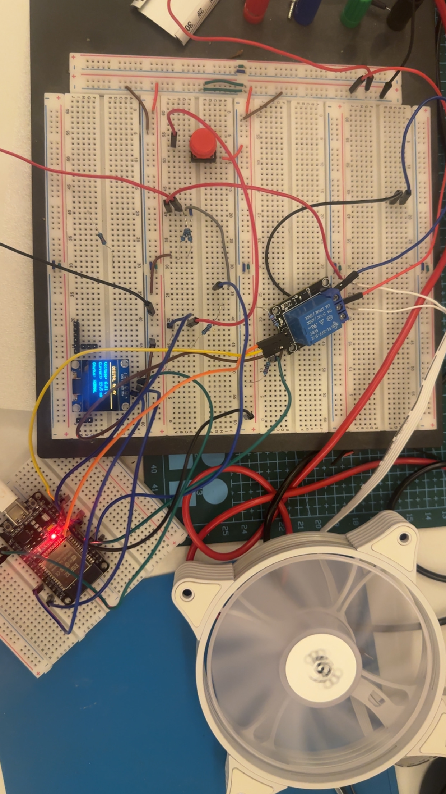
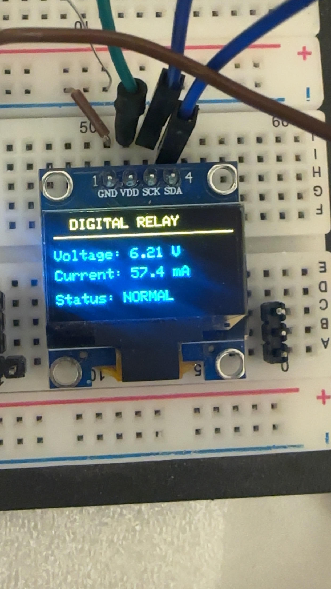
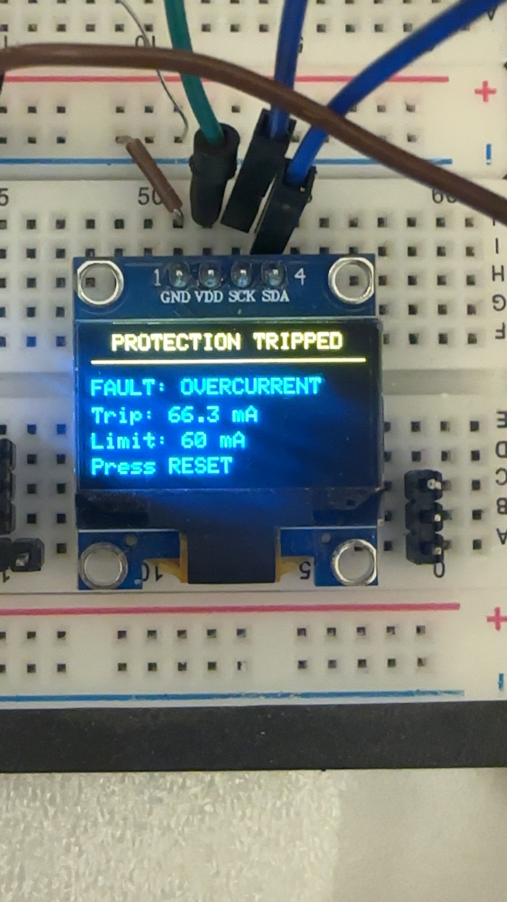

# ESP32 Digital Overcurrent Relay

I built this personal project while studying Power System Protection to explore overcurrent relay operation through a simple hands-on setup.

It uses an ESP32 to monitor a DC fan's voltage and current, display them on an OLED, and switch the relay off when an overcurrent is detected.

## Components

ESP32, SSD1306 OLED, 5V relay module, DC fan, pushbutton, a 10kΩ/2.15kΩ voltage divider, and two 10Ω resistors in parallel as a 5Ω shunt.

## Operation

- Trip limit: **60mA**
- Startup delay: **2 seconds**
- Trip condition: **3 consecutive readings above the limit**
- Press the reset/start button to start or restart after a trip.

## Circuit

[Editable Fritzing file](hardware/ESP32-Relay.fzz) · The motor symbol represents the DC fan.

## Hardware

## Results

| Normal operation — 6.21V, 57.4mA | Overcurrent trip — 66.3mA |
|---|---|
|  |  |

## Code

[Arduino sketch](firmware/finalCode/finalCode.ino) — uses the Adafruit SSD1306 and Adafruit GFX libraries.

